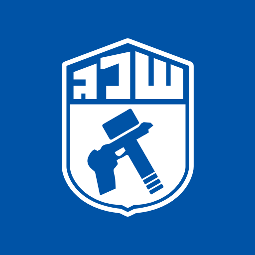

# Sheleg Organizer for Claude

The official plugin that connects Claude Code to **Sheleg Organizer**, Sheleg Lavan's shift-scheduling system. Once it is installed and you have signed in, Claude works in the system as you, with exactly your permissions. It can set up projects, open accounts, manage workers, and build, check and publish rosters.

<div dir="rtl">

## התקנה מהירה (Claude Code)

1. מתקינים פעם אחת, בטרמינל:

   ```sh
   claude plugin marketplace add https://github.com/OrMizrahi12/sheleg-organizer-plugin.git
   claude plugin install sheleg-organizer@sheleg-lavan
   ```

2. פותחים את Claude Code, מקלידים ‎`/plugin`‎, נכנסים ל־**Marketplaces**, בוחרים ‎`sheleg-lavan`‎ ולוחצים **Enable auto-update**. כך התוסף מתעדכן לבד.
3. מקלידים ‎`/mcp`‎, בוחרים ‎`plugin:sheleg-organizer:sheleg`‎ ולוחצים **Authenticate**. נפתח בדפדפן דף הכניסה של Sheleg Organizer: נכנסים בתעודת זהות ובסיסמה.
4. בודקים: ‎`/sheleg-organizer:connect`‎. Claude יגיד בשם מי הוא פועל.

הסוכן פועל בדיוק בהרשאות שלכם. כל פעולה שלו נרשמת ביומן הפעולות. את החיבור מבטלים בכל רגע במערכת, בדף "סוכנים › חיבורי סוכן", בכפתור "ביטול חיבור".

ב־Claude Desktop או ב־claude.ai: ‏Customize › Connectors › Add custom connector, ובשדה הכתובת: ‎`https://sheleg-organizer-api.fly.dev/mcp`‎.

### הרצת המנוע במחשב שלכם

ב־Claude Code, ריצת מנוע לבניית סידור נפתרת במחשב שלכם ולא בשרת: השרת רק מוסר את נתוני הריצה ומקבל בחזרה את התוצאה, וההחלה על הטיוטה עוברת את אותם כללים כמו תמיד. לשם כך צריך את ‎[uv](https://docs.astral.sh/uv/)‎. אם הוא חסר, Claude יציע להתקין אותו במתקין הרשמי. בהרצה הראשונה מורדים Python והמנוע, ולכן היא אורכת יותר. כשהמחשב לא יכול לפתור, Claude מריץ את המנוע בשרת, כך שתמיד מתקבל סידור. במערכת, ליד כל ריצה שנפתרה אצלכם, מופיע "במחשב המנהל". ב־Claude Desktop וב־claude.ai הריצה נפתרת בשרת.

</div>

## Before you start

- **A manager's account.** Project managers, company admins and the root admin connect agents. Workers cannot.
- **Agents switched on for your company.** A company admin controls this. When it is off, every agent connection of the company stops.
- **Claude Code** in a terminal, the desktop app or an IDE, with `git` on the machine. The marketplace is a public git repository, so no GitHub account is needed.

## Install

Run these two commands once, in a terminal:

```sh
claude plugin marketplace add https://github.com/OrMizrahi12/sheleg-organizer-plugin.git
claude plugin install sheleg-organizer@sheleg-lavan
```

The first adds this marketplace, named `sheleg-lavan`. The second installs the plugin for your user, in every project. Inside a Claude Code session, the same commands work with `/plugin` in place of `claude plugin`.

**Turn on automatic updates (once).** Claude Code updates a marketplace by itself only when you allow it. Type `/plugin`, open **Marketplaces**, choose `sheleg-lavan` and select **Enable auto-update**. From then on, new releases arrive in the background, and Claude Code says `Plugin updated` and asks you to run `/reload-plugins`.

## Sign in

1. Start Claude Code and type `/mcp`.
2. Choose `plugin:sheleg-organizer:sheleg`, which shows **Needs authentication**, and press **Authenticate**.
3. Your browser opens the system's page "חיבור סוכן לחשבון שלך". Enter your ID number and password there, never in the chat.
   - Leave "קריאה בלבד" (read only), "ללא פרסום" (no publishing) and "ללא מחיקה" (no deletion) unticked for full use, or tick them to narrow this connection.
   - If you manage more than one project, a second page asks which projects the agent may reach.
4. The browser returns to Claude Code with "Authentication successful". `/mcp` now shows the server as connected.

The connection does not expire. Claude Code keeps it in its own credential store, so every later session on this computer is connected.

## What you get

- **The server's tools.** One for each action your grade allows, the same actions as on the screens, with the same checks, warnings and blocks. A new capability in the system is a new tool at once, with no plugin update.
- **The `guide` skill.** Claude loads it whenever you work with the system. It teaches the system's words, grades and rules, and how to work safely:
  - It proposes one plan and waits for your yes before bulk changes.
  - It asks before publishing or deleting.
  - It never invents names, ID numbers or phone numbers.
  - It never handles a password you chose.
- **`/sheleg-organizer:connect`.** It checks the connection and says who Claude acts as, or how to sign in.
- **Engine runs solved on your computer.** See below.

Try, for example: "Show me the open slots in next week's roster", or "Here is the staffing table of the new campus: set it up as a project".

## Engine runs solve on your computer

In Claude Code, when Claude builds a roster with the engine, the engine runs **on your computer**, not on the system's server. The server only hands out the run's input and takes back the result. Applying the result to the draft passes through the same rules as always, and the system marks the run "במחשב המנהל" (on the manager's computer).

- **What it needs:** [uv](https://docs.astral.sh/uv/), which provides Python and the engine's libraries. If uv is missing, Claude offers to install it with its official installer from astral.sh. The first run downloads Python and the engine, so it takes a minute or two longer; later runs reuse them.
- **What passes through your computer:** the run's input and result, through short-lived links, and the engine itself, checked against the checksum the server names. They hold ids, hours and rules, not names. The input and result are deleted from your computer when the run ends. The engine is kept in your cache folder and replaced whenever the system's engine changes.
- **When it falls back to the server:** when uv cannot be installed, the download fails, the engine fails or takes too long, or the server refuses the result. Claude says so in one line and runs the engine on the server instead, so you always get a roster. A run left waiting for your computer fails by itself after 20 minutes and never holds the roster.
- **Claude Desktop and claude.ai** cannot run commands on your computer, so there the engine always runs on the server, as it does in the system's screens.

## Narrow, revoke or remove

- **Narrow or revoke.** On the system's page "סוכנים › חיבורי סוכן", every connection is listed with its narrowing and last use. You can narrow it there, or press "ביטול חיבור" to revoke it. The agent's next request is refused.
- **Sign out on this computer.** Type `/mcp`, choose the server and select **Clear authentication**. To connect again, select **Authenticate**.
- **Remove the plugin:** `claude plugin uninstall sheleg-organizer@sheleg-lavan`. To also remove the marketplace: `claude plugin marketplace remove sheleg-lavan`.

Every action an agent takes is recorded in the system's audit log, with the connection that took it. What the agent reads is sent to the model provider of your Claude account, under your organization's terms.

## Claude Desktop and claude.ai

Claude Desktop and claude.ai connect to the same server as a **custom connector**. Plugins and skills do not apply there, but every tool does.

1. **Pro or Max:** open **Customize › Connectors**, press **+ Add**, then **Add custom connector**. **Team or Enterprise:** an owner adds it once under **Organization settings › Connectors** (**Add › Custom › Web**), and each member then connects to it.
2. Name it `Sheleg Organizer`, with this server URL:

   ```
   https://sheleg-organizer-api.fly.dev/mcp
   ```

3. For sign-in, keep the detected OAuth settings. If you are asked how to register the client, choose **Register automatically**.
4. Connect. The same sign-in page opens: enter your ID number and password.

## Updates

Releases are versioned. With auto-update on, they arrive by themselves. To update by hand:

```sh
claude plugin marketplace update sheleg-lavan
claude plugin update sheleg-organizer@sheleg-lavan
```

Then run `/reload-plugins` in an open session, or start a new one.

A release can move the server to a new address, for example when the system moves to its own domain. A connection is tied to the address it was made with. After such a release, `/mcp` shows the server as **Needs authentication** again: sign in once more, as above.

## Troubleshooting

| What you see | What to do |
|---|---|
| `git` is not found, or the marketplace cannot be added | Install git, then run the two install commands again. On a network that blocks GitHub, ask your IT to allow `github.com`. |
| The server shows **Needs authentication** | Sign in as above. |
| The sign-in page refuses: "חיבור סוכנים פתוח למנהלים בלבד" | Your account is a worker's. Only managers connect agents. |
| Calls are refused with `agents_disabled` | Your company's agent switch is off. Ask your company admin. |
| The server was connected, and now every call fails | The connection was revoked on the web page. In `/mcp`, use **Clear authentication**, then **Authenticate**. |
| Two Sheleg Organizer servers appear in `/mcp` | An older manual registration is still there. Remove it with `claude mcp remove sheleg-organizer -s user`. |
| The tools are missing after an update | Run `/reload-plugins`, or start a new session. |
| Claude says the engine could not run on your computer | It ran on the server instead, so nothing is lost. To solve locally next time, check that `uv --version` works in a terminal. Behind a proxy, uv needs access to `pypi.org`, `files.pythonhosted.org` and `github.com`. |

## About this repository

This repository is the plugin's marketplace, published from the system's own repository at every release. Changes made here directly are overwritten. Each release is tagged `sheleg-organizer--v<version>`.
